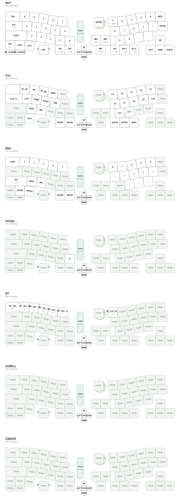

# Polaris ZeroShift 開発版

[今回の左右 UF2 を ZIP でダウンロード](firmware/downloads/Polaris-ZeroShift-recovery-r02.zip)。同じ ZIP の左右を対応する側に書き込み、設定した側を再起動してください。

左右間の無線接続で、親機がスキャンを開始できない場合や子機が広告を開始できない場合は、1・2・4・8・16秒の間隔で最大5回再試行します。スリープ中は再試行を休止します。

左右それぞれに対応する UF2 を一度書き込み、左側を USB または BLE 経由で [ZeroShift Web UI](https://te9no.github.io/zmk-feature-zeroshift/) に接続します。初期状態は左右ともオフです。左右とも PMW3610、エンコーダ、PAT9125（R02 I²C）、LPPS（ADS1220）、1u キー、Cirque タッチパッドを選べます。左側はアナログスティックにも対応します。IQS9151 は右側に加え、実機検証用に左側でも選べます。

1. 左右の電源を入れて「設定する側」を選び、モジュールを選択して保存します。
2. 設定した側の電源を切ってモジュールを取り付け、再起動します。
3. 左側を再起動した場合は再接続し、右側を再起動した場合は再読込して「起動中」の表示を確認します。

### OLED と四連 LED の交換

左手の「左手の表示モジュール」で OLED または四連 LED を選び、「設定を保存」を押します。左手の USB と電池電源を切ってから基板を交換し、再起動して Web UI に再接続してください。

四連 LED は起動時に虹色、続いて左右の接続状態、その後は左2灯で左手、右2灯で右手の電池残量を表示します。左 Cirque は表示ソケットの P1.14 を使用するため、四連 LED と同時には選べません。左 Cirque の使用時は OLED も停止します。

### UF2 のダウンロードと書き込みモード

片側ずつリセットを素早く2回押し、表示されたドライブに左右の対応する UF2 をコピーします。

更新後は各側に1つずつ USB シリアルポートがあります。Web UI を切断してから対象側のポートを 1200 bps・DTR オンで開き、約1秒後に DTR をオフにして閉じると、書き込み用ドライブが現れます。左は通常の Studio 接続にも同じポートを使います。

### 設定と配線

[機種・選択肢の定義](config/zeroshift.json) を親機が共通 Web UI に返します。[左右のビルド設定](build.yaml) は `polaris-zs-left` と `polaris-zs-right` を使います。各モジュールの配線は[シールドのデバイスツリー定義](boards/shields/GeaconPolaris/modules/)にあり、起動時に選んだドライバーが初期化されます。

# GeaconPolaris

**GeaconPolaris is not merely a keyboard. It is a split navigation instrument.**

Built on [ZMK Firmware](https://zmk.dev/), Polaris brings typing, pointing,
scrolling, and hardware experimentation into one modular ergonomic device.
Stable left and right base shields form the platform. Trackballs, touchpads,
encoders, analog controls, and an IQS9151 module define the route from there.

Polaris is the North Star of the Geacon lineage: a practical keyboard, a
platform for experimenting with pointing devices, and a record of how those
experiments become maintainable firmware.

## Features

- ZMK split keyboard targeting `xiao_ble//zmk`.
- Stable `Polaris_L_Base` and `Polaris_R_Base` shields.
- Each half reports its ZeroShift choices to the Web UI.
- Seven layers: `DEF`, `FUNC`, `NUM`, `SNIPE`, `BT`, `SCROLL`, and `SSNIPE`.
- Runtime combo and macro support for DYA Studio.
- Device information, watchdog, key-switch, PMW3610, and stack-usage diagnostics.
- Portrait OLED with both battery levels, layer, BLE profile and status.
- Local and GitHub Actions builds driven by the same `build.yaml`.

## Keymap

The source of truth is [`config/Polaris.keymap`](config/Polaris.keymap).

| Constant | Layer | Purpose |
| --- | --- | --- |
| `DEF` | `default_layer` | Main typing and access to other layers |
| `FUNC` | `function_layer` | Function keys, navigation, and layout shift |
| `NUM` | `num_layer` | Numbers, symbols, and editing/navigation keys |
| `SNIPE` | `snipe_layer` | Precision-oriented pointer controls |
| `BT` | `bt_layer` | BLE profile selection and clearing |
| `SCROLL` | `scroll_layer` | Scroll-oriented sensor bindings |
| `SSNIPE` | `SSNIPE_layer` | Precision scroll/sensor bindings |

The keymap also defines language-switching combos and runtime sensor-rotate
behaviors. The generated SVG includes combo geometry.

## DYA Studio and Diagnostics

The ZMK 0.4-based DYA Studio stack is pinned in
[`config/west.yml`](config/west.yml). The firmware includes support for:

- runtime combos and macros;
- device and build information;
- watchdog and freeze history;
- key-switch diagnostics;
- PMW3610 diagnostics with split relay support;
- thread stack-usage diagnostics;
- runtime input-processor and module-specific RPC settings.

The normal firmware keeps these diagnostics available so a device can explain
its state without requiring a private debug build. All right-hand artifacts
also expose CDC Debug and the 1200-baud bootloader trigger.

## OLED

The left-side SSD1306 is physically mounted in portrait orientation. The
`nice_oled` module displays:

- central battery level;
- peripheral battery level;
- active layer;
- BLE profile number and connection-state icon;
- a small animated cat in the remaining area.

## Repository Structure

| Path | Purpose |
| --- | --- |
| `config/Polaris.keymap` | Layers, combos, and behavior bindings |
| `config/west.yml` | Pinned ZMK and module revisions |
| `boards/shields/GeaconPolaris/Polaris.dtsi` | Shared include entry point |
| `boards/shields/GeaconPolaris/Polaris_hardware.dtsi` | Shared hardware nodes |
| `boards/shields/GeaconPolaris/Polaris_layout.dtsi` | Physical layout and matrix transform |
| `boards/shields/GeaconPolaris/Polaris_modules.dtsi` | Studio module metadata |
| `boards/shields/GeaconPolaris/Polaris_pins.dtsi` | Centralized pin assignments |
| `boards/shields/GeaconPolaris/Polaris_L_Base.overlay` | Left base, matrix, OLED, and I2C |
| `boards/shields/GeaconPolaris/Polaris_R_Base.overlay` | Right base and split offset |
| `snippets/` | Unified, diagnostic, simulation and bootloader build snippets |
| `keymap-svg/Polaris.svg` | Generated physical-layout keymap |
| `build.yaml` | Firmware build matrix |
| `firmware/` | CI firmware grouped by repository and branch |

## Philosophy

A conventional keyboard config asks which key sends which code. Polaris asks a
larger question: how many forms of input can a split ergonomic device support
without turning its firmware into an opaque collection of special cases?

The answer is implementation: stable base shields, module device trees,
centralized pin definitions, pinned dependencies, visible build routes,
diagnostics, and generated documentation. The mythology works only because the
code carries it.

## Documentation TODO

- Physical module mounting and replacement procedure.
- Electrical hot-swap safety.
- Battery, charging, and expected runtime details.
- User-facing examples for `layout_shift.dtsi` and each precision layer.
- Hardware photographs for each module route.

## License

See [`LICENSE`](LICENSE).

---

# GeaconPolaris 日本語版

**GeaconPolaris は、単なるキーボードではありません。分割された航法装置です。**

ZMK を土台に、文字入力、ポインティング、スクロール、入力モジュールの
実験を、ひとつの分割エルゴノミクスデバイスにまとめています。左右の
base shield を安定した土台とし、その上にトラックボール、タッチパッド、
エンコーダー、アナログ入力、IQS9151 を選択できます。

Polaris は Geacon 系譜の北極星です。実用できるキーボードであり、入力
デバイスの実験場であり、実験を保守可能な firmware に変えるための到達点
でもあります。

## 特徴

- `xiao_ble//zmk` を対象にした ZMK 分割キーボード。
- `Polaris_L_Base` / `Polaris_R_Base` を共通の土台として使用。
- 接続した親機から左右の選択肢を読み込みます。
- `DEF`, `FUNC`, `NUM`, `SNIPE`, `BT`, `SCROLL`, `SSNIPE` の 7 レイヤー。
- DYA Studio の runtime combo / macro と各種診断機能に対応。
- 左側の縦置き OLED に左右バッテリー、レイヤー、BLE profile と
  接続状態、アニメーションを表示。

## キーマップ

キーマップの正本は [`config/Polaris.keymap`](config/Polaris.keymap) です。

| 定数 | レイヤー | 役割 |
| --- | --- | --- |
| `DEF` | `default_layer` | 通常入力と各レイヤーへの入口 |
| `FUNC` | `function_layer` | Function key、navigation、layout shift |
| `NUM` | `num_layer` | 数字、記号、編集・移動キー |
| `SNIPE` | `snipe_layer` | 精密なポインター操作 |
| `BT` | `bt_layer` | BLE profile の選択・消去 |
| `SCROLL` | `scroll_layer` | スクロール用 sensor binding |
| `SSNIPE` | `SSNIPE_layer` | 精密スクロール用 sensor binding |

言語切替 combo と runtime sensor rotate behavior もここで定義しています。

## DYA Studio と診断

[`config/west.yml`](config/west.yml) には ZMK 0.4 系の DYA Studio 構成を
commit SHA で固定しています。firmware は次の診断機能を含みます。

- device/build information;
- watchdog と freeze history;
- key-switch diagnostics;
- split relay を含む PMW3610 diagnostics;
- thread stack usage;
- runtime input processor とモジュール固有 RPC。

IQS の詳細 serial log だけは負荷を分離するため `_DEBUG` artifact に
限定しています。

## OLED

左側の SSD1306 は物理的に縦向きです。表示内容は次のとおりです。

- Central と Peripheral のバッテリー残量。
- 現在のレイヤー。
- BLE profile 番号と接続状態アイコン。
- 空き領域の小さな猫アニメーション。

## 設計思想

一般的な keyboard config は「どのキーがどの code を送るか」を扱います。
Polaris が扱うのは、分割入力装置がどれだけ異なる入力形態を受け入れながら、
firmware を特殊処理の塊にせず保てるか、という問題です。

答えは実装として残しています。安定した base shield、モジュールごとの配線定義、
集約した pin 定義、固定した依存 revision、見える build route、診断機能、
生成ドキュメントです。世界観は、実装が支える範囲にだけ置いています。

## 未整備のドキュメント

- モジュールの物理的な取り付け・交換手順。
- 通電中の交換可否。
- バッテリー、充電、想定稼働時間。
- `layout_shift.dtsi` と各 precision layer の利用例。
- 各モジュール構成の写真。

## License

[`LICENSE`](LICENSE) を参照してください。
